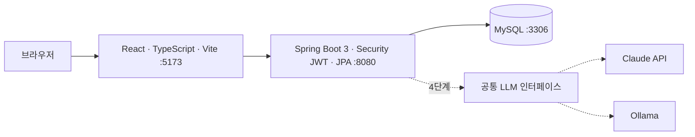
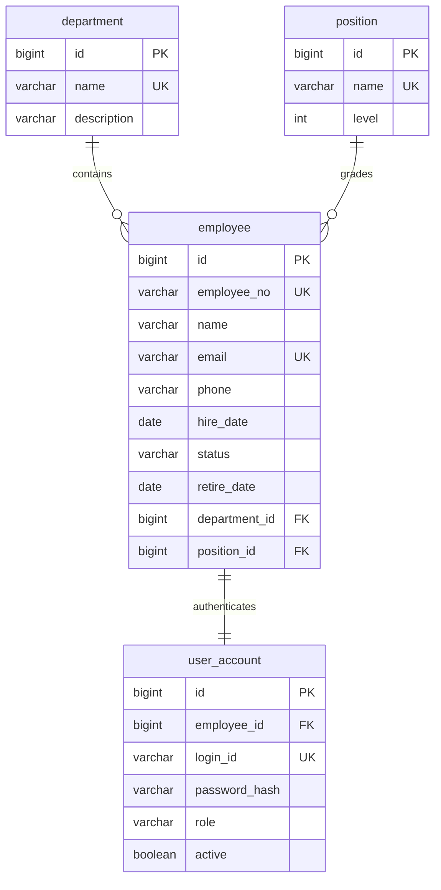

# 아키텍처와 MVP 계약

상태: 킥오프 기준 설계 초안. 구현 완료를 의미하지 않습니다. 백엔드 최종 스키마와 대조 후 갱신합니다.

## 시스템 구성

Docker Compose가 MySQL·백엔드·프론트엔드를 로컬에서 구성합니다. Ollama는 향후 선택 서비스입니다. 백엔드는 `http://localhost:5173` CORS를 허용합니다. Flyway가 스키마 변경을 관리합니다. 제품 LLM 자격증명과 호출은 백엔드에서 관리합니다.

## MVP ERD 초안

계정 분리 방식은 초안이며 백엔드가 계정 필드를 employee에 통합할 수 있습니다. employee_id는 계정당 유일하도록 설계합니다. login_id=employee_no, role=ADMIN/EMPLOYEE, status=ACTIVE/ON_LEAVE/RETIRED입니다. retire_date는 퇴사 시 기록합니다. 퇴사 시 계정을 비활성화하고 매 요청에서 활성 여부를 확인합니다. 사번 재사용 및 물리 삭제 API는 없습니다. 부서·직급 삭제 시 퇴사자까지 참조 여부를 검사합니다. 관리자 1개와 합성 데모 사원 약 30명을 시드로 제공합니다.

## API 계약 요약

상세 문서: [docs/api/mvp-api.md](api/mvp-api.md) — 백엔드팀 작성 예정. 링크 대상이 생성되기 전까지 아래와 킥오프 결정이 기준입니다. 계약 변경은 검토 기록에 질문하고 양 팀에 공유된 결정만 반영합니다.

- Base `/api/v1`, JSON, `Authorization: Bearer <token>`.
- 날짜 `YYYY-MM-DD`, 시각은 오프셋을 포함한 ISO-8601, Asia/Seoul 기준.
- 페이지 `{content, page, size, totalElements, totalPages}`. page=0부터, size 기본 20·최대 100. `sort=필드,asc|desc`, 허용 필드 employeeNo/name/hireDate.
- 오류 `{code, message, fieldErrors:[{field, reason}]}`. 400 VALIDATION_ERROR, 401 UNAUTHORIZED, 403 FORBIDDEN, 404 NOT_FOUND. 409는 DUPLICATE_EMPLOYEE_NO, DUPLICATE_EMAIL, DUPLICATE_NAME, DEPARTMENT_IN_USE, POSITION_IN_USE.

| 메서드·경로 | 권한·내용 |
| --- | --- |
| POST /auth/login | loginId/password → accessToken, tokenType=Bearer, expiresIn=3600, user={id,employeeNo,name,role} |
| GET /auth/me | 인증 사용자 → user |
| GET /employees | ADMIN; keyword(이름·사번·이메일), departmentId, positionId, status, page, size, sort |
| GET /employees/{id} | ADMIN 또는 본인 |
| POST /employees | ADMIN; employeeNo,name,email,phone,hireDate,departmentId,positionId,role,initialPassword |
| PUT /employees/{id} | ADMIN; name,email,phone,hireDate,status(ACTIVE/ON_LEAVE),departmentId,positionId,role |
| POST /employees/{id}/retire | ADMIN; retireDate |
| GET /departments | 인증 사용자; id,name,description |
| POST /departments | ADMIN; 부서 등록 |
| PUT /departments/{id} | ADMIN; 부서 수정 |
| DELETE /departments/{id} | ADMIN; 소속 사원 존재 시 409 |
| GET /positions | 인증 사용자; id,name,level(정수) |
| POST /positions | ADMIN; 직급 등록 |
| PUT /positions/{id} | ADMIN; 직급 수정 |
| DELETE /positions/{id} | ADMIN; 소속 사원 존재 시 409 |

회의 전달문의 부서·직급 POST/PUT/DELETE 합쳐진 표기를 위와 같이 등록은 컬렉션, 수정·삭제는 ID 경로로 풀어 적었습니다. 백엔드 상세 계약에서 의도와 다르면 설계 검토 확인 후 갱신합니다.

Employee 응답 필드: id,employeeNo,name,email,phone,hireDate,status,retireDate,department={id,name},position={id,name,level},role. 기본 목록은 RETIRED 제외이며 status 필터로 퇴사자를 조회할 수 있습니다.

Access token만 사용하고 refresh는 없습니다. 프론트 sessionStorage 보관, 401 시 로그인 이동, 로그아웃 시 클라이언트 토큰 삭제입니다. 로그아웃 자체가 서버 토큰을 폐기하지 않는 한계와 저장 방식의 근거는 백엔드 인증 ADR에 기록합니다.

## 검증 및 소유권

문서QA는 공통 문서와 초기 Git, 백엔드는 backend·Compose·상세 API·백엔드 ADR, 프론트는 frontend(Dockerfile 포함)·프론트 ADR을 담당합니다. Compose는 백엔드 단일 편집입니다. MySQL 통합 검증은 Testcontainers 또는 Compose로 수행하며 미실행과 통과를 구분합니다.
