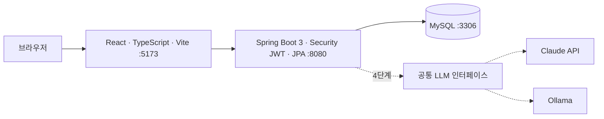
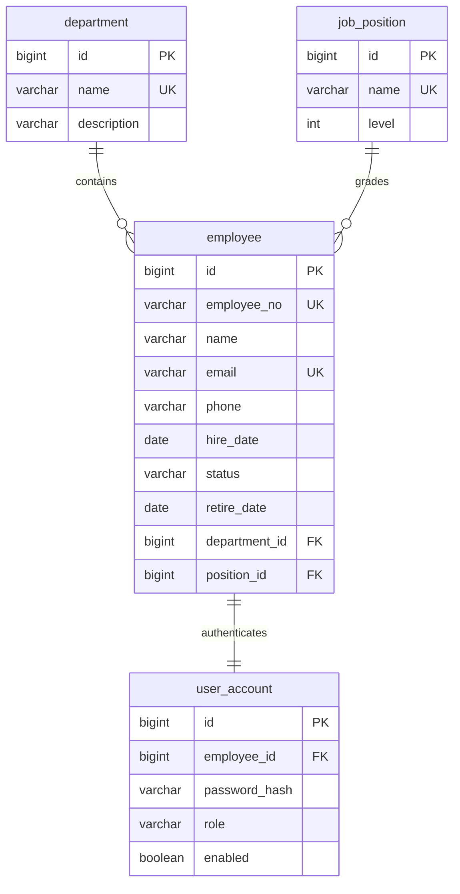
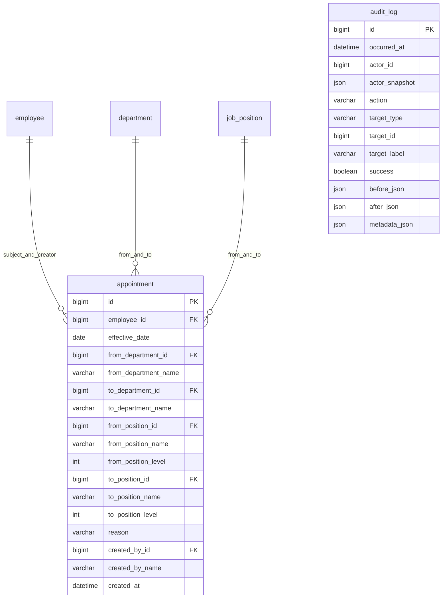

# 아키텍처와 MVP 계약

상태: 1단계 구현 및 실제 통합 검수 기준. Flyway V1 마이그레이션과 대조했습니다. [통합 검수 결과](qa/2026-10-16-mvp-integration.md)를 참조합니다.

## 시스템 구성

Docker Compose가 MySQL·백엔드·프론트엔드를 로컬에서 구성합니다. Ollama는 향후 선택 서비스입니다. 백엔드는 `http://localhost:5173` CORS를 허용합니다. Flyway가 스키마 변경을 관리합니다. 제품 LLM 자격증명과 호출은 백엔드에서 관리합니다.

## MVP 실제 ERD

실제 테이블은 department, job_position, employee, user_account입니다. user_account.employee_id는 NOT NULL UNIQUE FK이며 별도 login_id 컬럼은 없습니다. 로그인 ID는 employee.employee_no입니다. role=ADMIN/EMPLOYEE, enabled는 계정 활성 여부, status=ACTIVE/ON_LEAVE/RETIRED입니다. retire_date CHECK는 RETIRED일 때 퇴사일이 입사일 이상이고, 그 외에는 NULL이도록 강제합니다. 사번·이메일·부서명·직급명에 UNIQUE, 상태·역할에 CHECK, hire_date/name/status에 인덱스가 있습니다. description/phone/retire_date 외 주요 필드는 NOT NULL입니다. 계정은 BCrypt 해시를 저장합니다. 퇴사 시 enabled=false로 바꾸고 매 요청에서 검사합니다. 사번 재사용 및 물리 삭제 API는 없습니다. 부서·직급 삭제는 퇴사자까지 검사합니다. Flyway V1이 부서·직급 각 3개를 만들고 런타임 시드가 빈 사원 테이블에 관리자 1개와 합성 사원 30명을 만듭니다.

## API 계약 요약

상세 문서: [docs/api/mvp-api.md](api/mvp-api.md). 킥오프 및 설계 검토 답변 을 반영한 계약입니다. 생성 201+객체/Location, 수정·퇴사 200+객체, 삭제 204입니다. User.id는 사원 ID입니다. 계약 변경은 검토 기록에 질문하고 양 팀에 공유된 결정만 반영합니다.

- Base `/api/v1`, JSON, `Authorization: Bearer <token>`.
- 날짜 `YYYY-MM-DD`, 시각은 오프셋을 포함한 ISO-8601, Asia/Seoul 기준.
- 페이지 `{content, page, size, totalElements, totalPages}`. page=0부터, size 기본 20·최대 100. `sort=필드,asc|desc`, 허용 필드 employeeNo/name/hireDate.
- 오류 `{code, message, fieldErrors:[{field, reason}]}`. 400 VALIDATION_ERROR, 401 UNAUTHORIZED, 403 FORBIDDEN, 404 NOT_FOUND. 409는 DUPLICATE_EMPLOYEE_NO, DUPLICATE_EMAIL, DUPLICATE_NAME, DEPARTMENT_IN_USE, POSITION_IN_USE.

| 메서드·경로 | 권한·내용 |
| --- | --- |
| POST /auth/login | loginId/password → accessToken, tokenType=Bearer, expiresIn=3600, user={id,employeeNo,name,role} |
| GET /auth/me | 인증 사용자 → user |
| GET /employees | ADMIN; keyword(이름·사번·이메일), departmentId, positionId, status, page, size, sort |
| GET /employees/{id} | ADMIN 또는 본인 |
| POST /employees | ADMIN; employeeNo,name,email,phone,hireDate,departmentId,positionId,role,initialPassword |
| PUT /employees/{id} | ADMIN; name,email,phone,hireDate,status(ACTIVE/ON_LEAVE),departmentId,positionId,role |
| POST /employees/{id}/retire | ADMIN; retireDate |
| GET /departments | 인증 사용자; id,name,description |
| POST /departments | ADMIN; 부서 등록 |
| PUT /departments/{id} | ADMIN; 부서 수정 |
| DELETE /departments/{id} | ADMIN; 소속 사원 존재 시 409 |
| GET /positions | 인증 사용자; id,name,level(정수) |
| POST /positions | ADMIN; 직급 등록 |
| PUT /positions/{id} | ADMIN; 직급 수정 |
| DELETE /positions/{id} | ADMIN; 소속 사원 존재 시 409 |

부서·직급 등록은 컬렉션 POST, 수정·삭제는 ID 경로이며 상세 API 및 실제 검수와 일치합니다. 퇴사자 수정·중복 퇴사는 409 EMPLOYEE_RETIRED, 잘못된 날짜는 400 VALIDATION_ERROR입니다.

Employee 응답 필드: id,employeeNo,name,email,phone,hireDate,status,retireDate,department={id,name},position={id,name,level},role. 기본 목록은 RETIRED 제외이며 status 필터로 퇴사자를 조회할 수 있습니다.

Access token만 사용하고 refresh는 없습니다. 프론트 sessionStorage 보관, 401 시 로그인 이동, 로그아웃 시 클라이언트 토큰 삭제입니다. 로그아웃 자체가 서버 토큰을 폐기하지 않는 한계와 저장 방식의 근거는 백엔드 인증 ADR에 기록합니다.

## 검증 및 소유권

문서QA는 공통 문서와 초기 Git, 백엔드는 backend·Compose·상세 API·백엔드 ADR, 프론트는 frontend(Dockerfile 포함)·프론트 ADR을 담당합니다. Compose는 백엔드 단일 편집입니다. MySQL 통합 검증은 Testcontainers 또는 Compose로 수행하며 미실행과 통과를 구분합니다.

## 2단계 실제 ERD와 API

[2단계 API 계약](api/phase2-api.md), Flyway V2__appointments_and_audit.sql 기준. V1 보존, appointment/audit_log 추가.

appointment는 대상/작성자 및 전후 조직 FK, 당시 이름·level 스냅샷, (employee_id,effective_date DESC,id DESC) 인덱스를 가집니다. audit_log의 actor/target은 nullable 논리 참조이며 FK가 아닙니다. DATETIME(6), JSON 스냅샷, 시간·actor·target·action·success별 시간/ID 인덱스를 사용합니다. 성공 업무/감사는 같은 트랜잭션, 실패 로그인/가져오기는 별도 기록입니다.

사원 PUT 조직 필드 생략/null/동일 값은 유지, 변경은409입니다. 발령은 행 잠금 후 DB 전 값을 읽어 현재 소속·이력·감사를 갱신합니다. 대시보드는 현재 상태/분포와 오늘까지의 날짜 집계를 구분합니다. 파일 한도·셀 형식·감사 허용 필드는 상세 API를 따릅니다.
