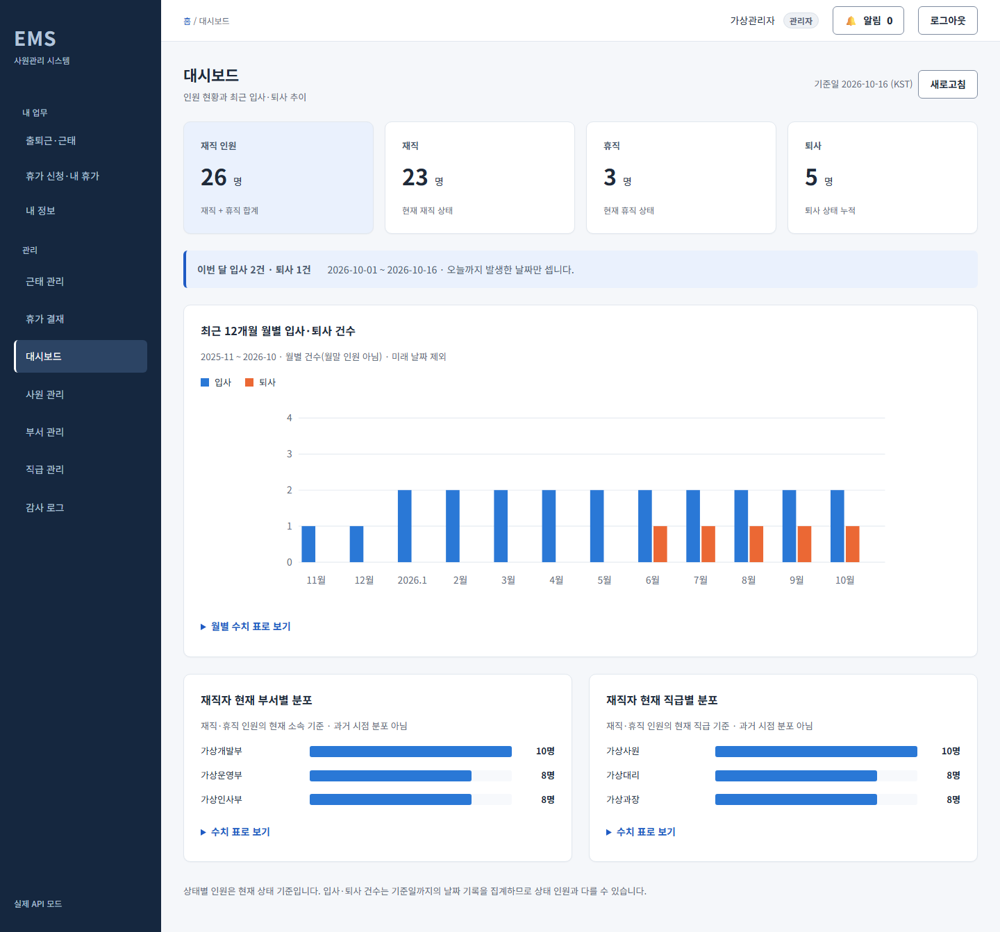
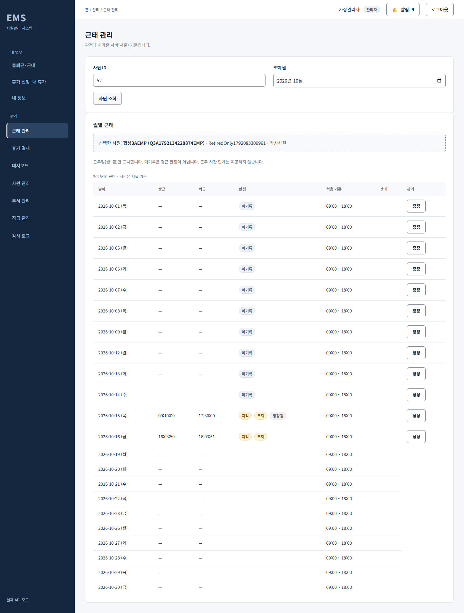
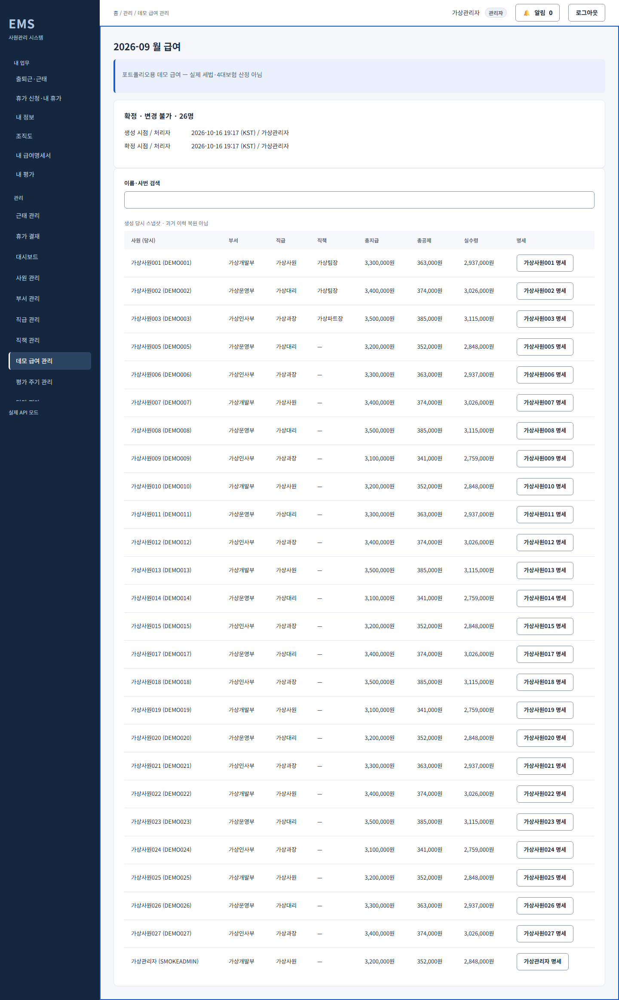
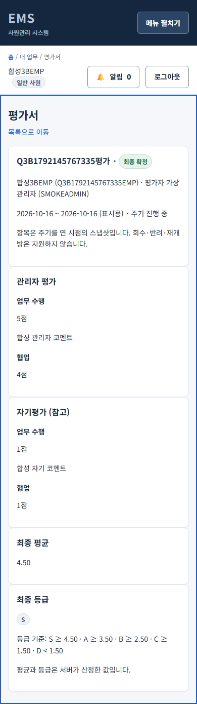
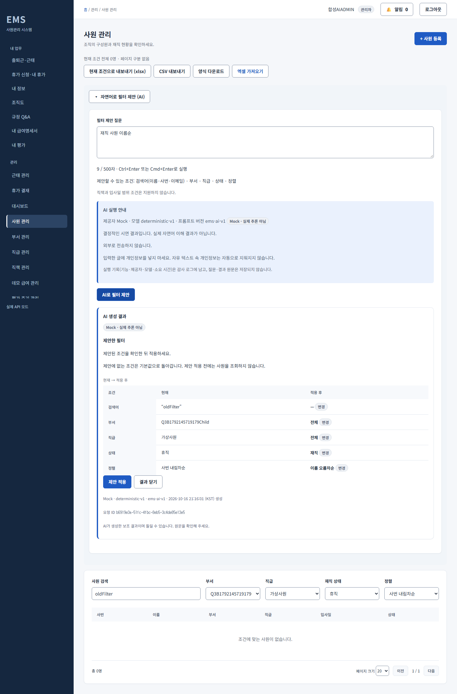
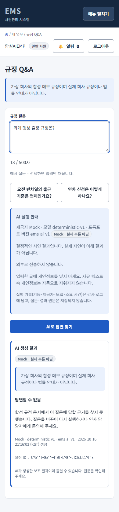

# EMS — Employee Management System

## 3A 사용과 새 DB 데모

내 업무에서 출퇴근·월근태·휴가 신청/잔액을, 관리에서 근태정정·휴가결재를 사용합니다. 다른 ADMIN만 승인/반려할 수 있습니다. 연차·근태는 **단순화한 데모 정책이며 법적 산정이 아닙니다.** 공휴일·출근율·유연/야간근무는 생략합니다. [정책표](01-requirements.md), [3A API](api/phase3a-api.md), [실제 검수·미실행·잔여](qa/2026-10-16-phase3a-integration.md).

새 빈 DB에는31명/31계정,퇴사5명·기본목록26명과12개월에 분산된 합성 입퇴사 데이터가 생성됩니다. 기본 관리자 외 DEMO001도 ADMIN입니다. `.env`의 선택값 `DEMO_ADMIN_INITIAL_PASSWORD`를 로컬 비밀번호로 설정하면 **새 시드 시에만** DEMO001 로그인에 사용합니다. 빈 값은 알 수 없는 임의비밀번호, 최대UTF-8 72바이트이며 기존 비밀번호를 재설정하지 않습니다. 유지DB는 기존입퇴사·이력·감사를 덮어쓰지 않습니다.

```powershell
# 기존 서비스가 종료되어 포트가 비어 있고,
# ems-demo3a 프로젝트/볼륨이 없는 경우에 새 DB로 시작
docker compose --project-name ems-demo3a --env-file .env up --build -d
docker compose --project-name ems-demo3a --env-file .env ps
# 사용 후 데이터 볼륨 유지
docker compose --project-name ems-demo3a --env-file .env down
```

같은 프로젝트를 다시 쓰면 새 빈DB가 아니라 유지DB입니다. 기존볼륨을 삭제하지 말고 다른 고유프로젝트를 사용합니다. 관리자는 자기결재가 금지되므로 다른 합성ADMIN으로 계정을 바꿔 결재합니다. 유지환경에서는 API/관리화면에서 합성ADMIN을 생성할 수 있습니다. 목업Chromium은5174,실제Compose웹은5173입니다.

디자인원본·재확인은 [Claude Code 검수](design/design-review-phase3a.md)7.2/7.5/8을 참조합니다. 낮음N-01~07·ExcelJS청크경고·프론트EOF빈줄3건은 3A 당시 잔여 기록입니다. 3B에서는 담당 변경 범위의 EOF를 프론트가 정리했고 현재 잔여는 3B 검수 보고서8~9절을 따릅니다.

백엔드 중심 풀스택 사원관리 웹 애플리케이션이자 **AI 활용 포트폴리오**입니다. 승인된 AI3기능까지 구현했습니다. 실제 Compose/MySQL/Chromium에서 기존62개 회귀와 AI12개 시나리오를 검수했습니다. 기본 Mock은 실제 추론이 아니며 실제 Claude/Ollama 추론은 키/기존서비스 부재로 미실행입니다.

## 기술 스택

- 백엔드: Spring Boot 3, JPA, Spring Security, JWT, Flyway
- 프론트엔드: React, TypeScript, Vite
- 데이터 및 실행: MySQL, Docker Compose
- 제품 AI: Mock / Claude API / Ollama 공통 LlmClient(실제 제공자 추론 미실행)
- 개발 AI: Codex 중심 구현·문서화, Claude Code 조율·검수

## 단계 로드맵

| 단계 | 범위 |
| --- | --- |
| 1 MVP | 사원·부서·직급 CRUD, 검색·필터·정렬·페이징, 로그인·권한 |
| 2 확장 1 | 대시보드, 발령 이력, xlsx 입출력·CSV 내보내기, 감사 로그 |
| 3A | 근태·정정, 휴가결재·예약/사용/복원, 알림 |
| 3B | 조직도·직책, 급여 데모, 평가 |
| 4 AI | Claude API/Ollama, 자연어 사원 검색, 평가 요약, HR 규정 챗봇 |

## 실행 방법

Docker Desktop 또는 Docker Engine과 Compose가 필요합니다. 3306/8080/5173 포트를 비워 두고 프로젝트 루트에서 실행합니다. 배포는 범위에 포함하지 않습니다.

```powershell
Copy-Item .env.example .env
# .env의 DB 비밀번호, JWT_SECRET, 관리자 ID/비밀번호를 로컬 값으로 편집
docker compose up --build -d
docker compose ps
docker compose logs backend
```

백엔드 준비가 끝난 뒤 [웹 화면](http://localhost:5173)에 접속합니다. API는 `http://localhost:8080/api/v1`, MySQL은 `localhost:3306`입니다. Compose는 frontend를 실제 API 모드로 빌드합니다. 브라우저에서는 localhost 주소를 사용합니다.

- `ADMIN_LOGIN_ID`: 필수 관리자 사번, 최대 50자, `DEMO###` 형식 금지.
- `ADMIN_INITIAL_PASSWORD`: 공백이 아닌 값, UTF-8 72바이트 이하.
- `JWT_SECRET`: 충분히 무작위인 로컬 값, 최소 UTF-8 32바이트. `.env.example`의 예시 문자열은 교체합니다.
- `DB_NAME`, `DB_USERNAME`, `DB_PASSWORD`, `DB_ROOT_PASSWORD`: Compose MySQL 설정. `DB_HOST`/`DB_PORT`는 로컬 백엔드 실행용이며 Compose 내부는 mysql:3306입니다.

초기 관리자 계정은 `.env`에서 정한 ID/비밀번호로 로그인합니다. 사원 테이블이 비어 있으면 관리자 1명과 합성 사원 30명이 생성됩니다. 데모 사원의 비밀번호는 알 수 없는 무작위 값이므로 일반 사원 시연은 관리 화면에서 사원을 등록하고 직접 정한 초기 비밀번호를 사용합니다. 기존 볼륨에서는 환경변수를 바꿔도 관리자 비밀번호가 초기화되지 않습니다. 실제 비밀값과 `.env`는 커밋하지 않습니다.

```powershell
# 사용 후 종료, 데이터 볼륨 유지
docker compose down
```

실제 통합 검수 재현은 [QA 문서](qa/2026-10-16-mvp-integration.md)를 참조합니다. 백엔드 테스트는 Java 21에서 `backend/gradlew.bat test integrationTest`, 프론트는 `npm ci`, `npm run typecheck`, `npm test`, `npm run build`로 실행합니다. 상세 절차는 각 팀 README에 있습니다.

## 실제 API 화면





## 문서

- [요구사항 및 인수 조건](01-requirements.md)
- [아키텍처·ERD·API 요약](02-architecture.md)
- [킥오프 결정](meetings/2026-10-16-kickoff.md)
- [AI 협업 방식](ai-workflow.md)
- [개발 일지](devlog/README.md) · [ADR](adr/README.md) · [회고](retrospective.md)

[상세 API 계약](api/mvp-api.md) · [MVP 통합 검수·결함 목록](qa/2026-10-16-mvp-integration.md). 각 팀의 자동 테스트 결과와 이번 실제 API 검수를 구분해 기록합니다.


## 2단계 기능과 증거

대시보드(현재 상태·12개월 입퇴사), 발령 전용 조직 변경·본인 이력, 실제 xlsx/CSV 다운로드·오류 시 전체 취소 가져오기, 관리자 감사 로그를 제공합니다. 관리자 첫 화면은 대시보드, 일반 사원은 내 정보입니다.

- [2단계 API](api/phase2-api.md) · [실제 통합 검수](qa/2026-10-16-phase2-integration.md)
- [종료·착수 회의](meetings/2026-10-16-phase1-closing.md) · [역할별 엔진 배분 ADR](adr/0002-task-based-engine-allocation.md)
- [디자인 시스템](design/design-system.md) · [시안](design/mockups.html) · [Claude Code 검수 기록](design/design-review-phase2.md)

디자인은 Claude, 구현·실제 검수는 Codex가 담당했습니다. 목업 디자인 검수와 실제 API 검증의 범위는 각각의 문서에서 구분합니다.

## 3B 기능과 새 DB 시드

조직 계층·직책 발령, 월 급여 생성/재계산/확정·본인 명세, 자기평가·관리자 평가/서버 등급을 제공합니다. **포트폴리오용 데모 급여 — 실제 세법·4대보험 산정 아님**. 공제는 총지급의450/350/300bps를 항목별 원 단위 HALF_UP으로 반올림하며 일할 계산은 없습니다. 직책은 ADMIN 권한을 주지 않고 팀장 휴가 승인은 제외합니다.

새 DB에는 기존31명·급여 설정31개, 직전 월 대상자만의 확정 명세와 혼합 상태 평가 주기1개가 생성됩니다. 이번 QA에서는 서울 기준2026-09 대상 조건으로 계산한26명과 명세26개가 일치했습니다. 과거월 명세는 생성 시점 설정·소속 스냅샷이며 과거 이력 복원이 아닙니다. 유지 볼륨에는 자동 재시드/명세 생성이 없습니다.

아래는 포트가 비어 있고 해당 프로젝트/볼륨이 없을 때만 새 DB를 만드는 예입니다. 위 실행 방법대로 .env를 먼저 설정하고 DEMO_ADMIN_INITIAL_PASSWORD를 지정하면 새 DB의 DEMO001(ADMIN)으로 자기 결재 금지를 시연할 수 있습니다. 같은 프로젝트 재사용은 유지 DB입니다. 기존 볼륨을 삭제하지 마세요.

```powershell
docker compose --project-name ems-demo3b --env-file .env up --build -d
docker compose --project-name ems-demo3b --env-file .env ps
# 사용 후 볼륨 유지
docker compose --project-name ems-demo3b --env-file .env down
```

[3B 정책](phase3b-policy.md) · [API v1.1](api/phase3b-api.md) · [실제 통합 검수](qa/2026-10-16-phase3b-integration.md) · [Claude Code 검수](design/design-review-phase3b.md) · [마무리 회의](meetings/2026-10-16-phase3b-finalization.md). 급여 파일 다운로드·평가 알림은 이번 범위가 아닙니다.





## AI 기능과 제공자 전환

- 사원 관리(ADMIN): 자연어로 기존5필드의 조건을 제안받고 비교표를 확인한 뒤 적용합니다. 제안에 없는 조건은 제거되는 전체 교체이며 수동 변경·되돌리기를 지원합니다. 직책·입사일 범위는 지원하지 않습니다.
- 확정 평가 상세: 본인 또는 배정 평가자가 코멘트를 읽기 전용으로 요약합니다. 점수·등급·원문을 바꾸거나 저장하지 않습니다.
- 규정 Q&A: 합성 데모 규정의 문서/버전/절·발췌를 보여 주며 근거가 없으면 답변하지 않습니다. 실제 회사 규정·법률 안내가 아니고 인용 일치가 의미 정확성을 보장하지 않습니다.

기본 EMS_AI_PROVIDER=mock은 결정적 시연이며 **실제 추론 아님**을 화면에 표시합니다. 키 없이 Compose 데모가 동작합니다. 제품 제공자와 개발 Codex/Claude 역할은 별개입니다.

| 로컬 .env 설정 | 값·의미 |
| --- | --- |
| EMS_AI_PROVIDER | mock / anthropic / ollama |
| EMS_AI_MODEL | mock 기본 deterministic-v1; Anthropic 기본 claude-sonnet-5-5는 설계 검토 설정 결정이며 실제 접근 성공과 별개; Ollama는 기존 설치 모델을 직접 지정 |
| ANTHROPIC_API_KEY | Anthropic 실호출을 원할 때 로컬 환경에만 지정, 저장소/로그에 넣지 않음 |
| OLLAMA_BASE_URL | Compose에서 호스트 Ollama는 http://host.docker.internal:11434, 호스트 직접 실행은 localhost:11434. 자동 모델 다운로드 없음 |
| EMS_AI_TIMEOUT_MS / EMS_AI_MAX_TOKENS | 기본30000 / 1024, 비스트리밍·자동재시도0 |

.env를 편집한 뒤 같은 프로젝트로 docker compose up -d --force-recreate backend를 실행하면 서버 설정을 다시 읽습니다. 현재 실행 프로젝트가 고유 이름이면 같은 --project-name/--env-file을 사용하세요. 제공자 실패·키 누락은 명시 오류이며 Mock으로 몰래 바꾸지 않습니다. /api/v1/ai/config는 키·URL을 제외한 설정만 공개하고 실제 호출 성공을 뜻하지 않습니다.

Anthropic/Ollama는 EMS 서버 프로세스 밖 전송이라 externalTransfer=true입니다(Ollama가 클라우드라는 뜻은 아님). 실행 전 전송 필드를 안내하며 질문/코멘트에 개인정보를 넣지 마세요. 자유 텍스트를 자동 익명화하지 않습니다. 입력/응답은 저장하지 않고 허용 메타데이터만 감사하며 브라우저 취소는 제공자 비용 취소를 보장하지 않습니다.

[AI 정책](phase4-ai-policy.md) · [AI API](api/phase4-ai-api.md) · [실제 QA·제공자별 증거](qa/2026-10-16-phase4-ai-integration.md) · [전체 목표/제외/미실행/잔여](completion-matrix.md). 실제 Claude/Ollama 추론은 미실행이며 Mock/로컬HTTP 계약 성공과 구분합니다.




