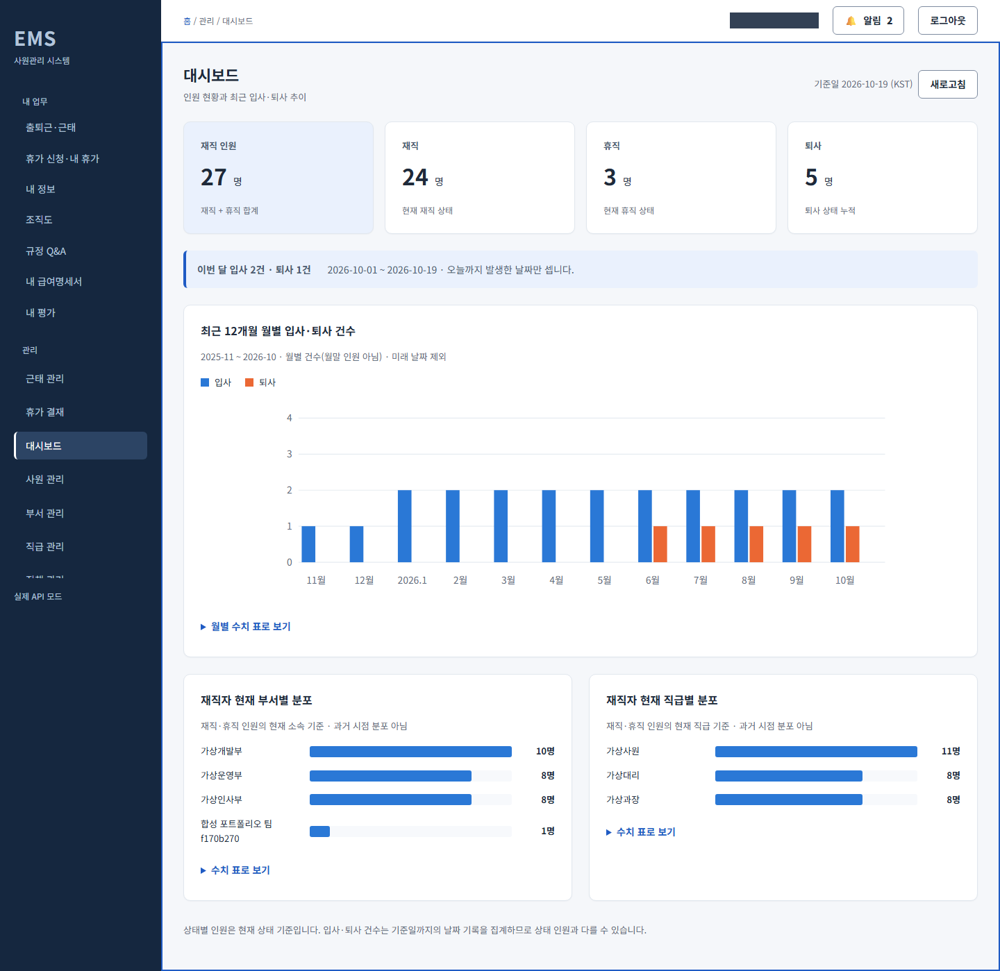
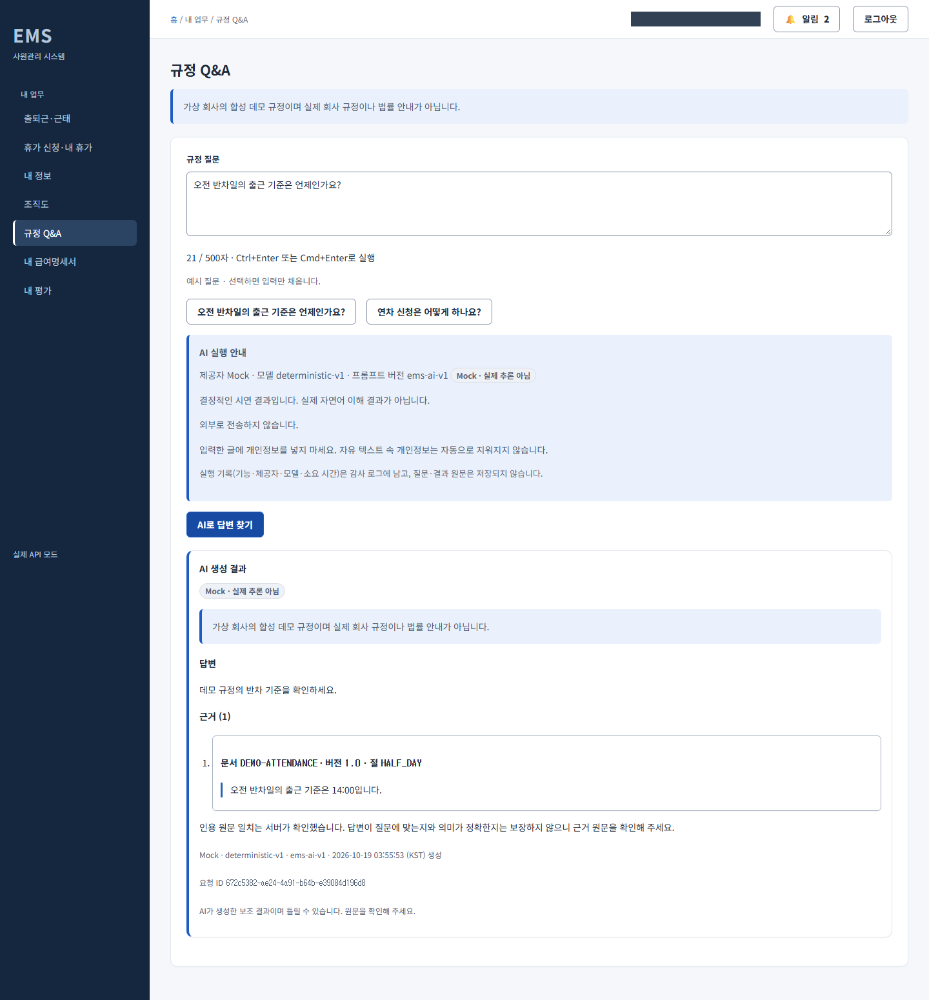
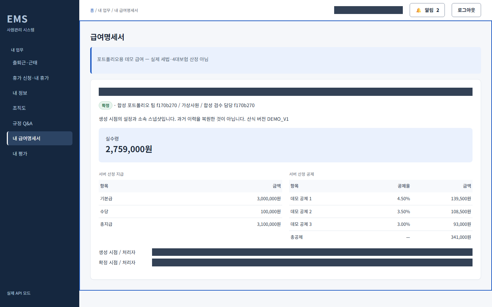

# 실제 API 포트폴리오 촬영 인계

공개용 표현 정리 과정에서 문서·JSON·스크립트의 파일명과 개발 과정 설명을 정리했다. JSON의 스크립트·화면 목록 해시는 현재 파일 기준으로 갱신했고, 실행 당시 값은 `historical` 접두사 필드와 변경 사유에 보존했다. 커밋 SHA와 PNG 해시는 바꾸지 않았다. 기록 파일이 자기 자신의 해시를 포함하는 구조는 사용하지 않는다.

**현재 상태: 실제 API + Mock LLM으로 37개 화면·PNG 53장 촬영 완료, 통합 목록의 누락 0건.** [통합 manifest](capture-set.json)와 [Claude Code 이미지 검수](claude-image-review.md)를 근거로 아래 갤러리를 연결했다. [별도 담당 HTTP 근거](../security/frontend-header-check-approved-run.json)에서 정상 GET 200·SPA fallback 200·POST 오류 405의 3개 헤더 일치를 확인했다. 촬영 프로젝트는 최종 승인 후 종료했고 볼륨을 보존했다([종료 근거](cleanup-final.json)). 공개 가능 여부의 최종 판단은 QA와 프론트 통합 검증 담당자에게 있다. 기존 `frontend/design-evidence` 목업 이미지는 이번 실제 API 결과에 포함하지 않는다.

- 촬영 준비·실행·manifest 작성: Codex 화면 구현. 이번 README·일지 갱신은 갤러리 정리이다.
- 이미지 검수: Claude Code UI·UX 디자이너, 이미지 검수. 실제 PNG 53장 모두를 열었고 53/53 파일 해시·크기를 대조했다. 자동 대조와 사람 확인은 검수 문서에서 구분한다.
- 실행·Docker·공유 환경·최종 판단 조율: 프론트 통합 검증 담당자. 촬영 환경 종료 명시적 종료 승인 후 프로젝트 `ems-photo-20261019-943cdb77d3`만 down했고 실행 프로세스도 종료했다. 명명 볼륨은 보존하고 공유 포트를 반환했다.
- 헤더 설정 보완에서 실제 실행 문서인 `backend/docs/portfolio-local-runbook.md`와 정상 API 준비를 정적으로 대조했고, 이후 초기 촬영부터 최종 촬영까지의 과정에서 아래 실행 결과를 확보했다. 이전의 `docs/portfolio-local-runbook.md` 부재 표기는 경로 착오였다.

## 실제 실행 결과와 보존 이력

전체 재실행 한도는 **3/3회 사용 완료**다. 이전 초기 촬영의 0장 실패, 이후 1차 12장·2차 25장 실패와 모든 원본 manifest·시도 원장·볼륨 보존 근거를 남겼다. 과거 실패 시도의 이미지는 최종 53장에 합산하지 않았다.

최종 세트는 같은 3차 프로젝트에서 확보한 [전체 촬영 49장](2026-10-18T18-54-38-906Z-f170b270/manifest.json)과 [허가된 AI 화면 재촬영 4장](2026-10-18T19-39-27-026Z-430432da/manifest.json)을 연결한 것이다. 전체 촬영의 AI 검색·요약 데스크톱/모바일 실패 4건은 원본 기록에 그대로 남아 있다. CSS 생성문자를 포함한 접근성 이름과 촬영 exact 선택자 불일치를 수정하고 해당 화면만 한 번 재촬영했다. 제품 코드는 변경하지 않았다. [시도 기록](capture-attempt-notes.md)과 [원장](capture-attempts.json)에 근거를 남겼다.

촬영 HEAD는 `89db9017fe3bbd025a26d4bb852c609fc7824607`이며 nginx 3개 헤더를 포함한 dirty 상태다. 전체 dirty 경로, 촬영 스크립트 해시, 역할·뷰포트·시각·모드·파일 해시는 manifest를 따른다. 같은 스택에서도 데스크톱 대시보드 27명과 모바일 28명은 중간 xlsx 가져오기로 달라진 실제 시점의 값이다(L-07). 숫자를 맞추거나 이미지를 편집하지 않았다.

## 실행 문서 대조와 남은 확인

실행 문서와 촬영 준비는 새 고유 Compose 프로젝트·빈 볼륨, 실제 API와 Mock LLM, 별도 합성 사원 정상 생성, 평일 과거 근태 정정, 잔여일수 내 미래 휴가, 다른 관리자의 승인, 급여 설정 후 월 생성·확정, 평가 배정·공개·제출, FINALIZED 평가의 ID만 전달하는 AI 요약 원칙이 일치한다. 기존 볼륨 삭제·DB 직접 쓰기·계산 결과 조작은 하지 않는다.

실행 문서의 연차/반차는 예시이며 스크립트는 SICK 휴가를 준비한다. 스크립트는 재실행 시 기존 합성 계정을 재사용하지 않고 충돌하면 중단하며, 기존 급여 월도 덮어쓰지 않는다. 새 사원 두 명의 급여 설정만 준비하므로 기존 대상자의 설정 누락은 서버 오류로 드러날 수 있다. 관리자 평가 작성 화면은 자기평가 제출 후 입력 상태를 촬영하며 관리자 임시저장 완료를 증명하지 않는다. 이 차이는 촬영 범위의 한계이며 서버 계약을 보완하거나 응답을 조작하지 않는다.

검토 담당자 복구·실행 허가 후 새 고유 프로젝트에서 정상 API 상태 준비와 촬영을 수행했다. 이미지 확인 범위와 남은 한계는 아래 Claude Code 판정을 따른다. 헤더 설정 보완의 nginx 3개 헤더는 서버 범위의 `always` 설정과 현재 유일한 location 상속을 정적으로 확인했다. 별도 담당 HTTP 헤더 확인는 2026-10-19 04:48:41 KST에 localhost:5173의 GET 200·SPA fallback 200·POST 405에서 nosniff/DENY/strict-origin-when-cross-origin를 확인했다. 이 결과는 프론트 헤더의 해당 요청 범위이며 nginx 구문 검사·API 보안 전반·전체 CSP 검증은 아니다.

## 고정 화면 목록

`screen-list.json`은 화면 ID, ADMIN/EMPLOYEE 역할, 경로 템플릿, 시나리오, 정상 API 준비 조건, 뷰포트, 파일명을 정의한다. 실제 확보는 화면 ID 37개, 데스크톱 37장·모바일 16장으로 총 53장이다. 뷰포트는 데스크톱 1440×900, 모바일 390×844이며 fullPage 이미지는 높이가 더 길다. 전체 페이지와 모달의 viewport 캡처를 `fullPage`로 구분한다.

범위는 빈 로그인, 대시보드, 사원 목록/상세/등록/발령, 부서/직급/직책/조직도, xlsx 가져오기와 성공 결과, 감사, 근태, 휴가 신청·결재·알림, 급여 생성 위치/초안/확정 확인/본인 명세, 평가 주기/자기·관리자 작성/확정 결과, AI 검색 비교표/요약/규정 답변·근거 부족이다. 화면 계정의 이름·사번은 마스킹하므로 사람의 식별값 검증용 이미지는 아니다.

## 실행 조건 참고 (추가 실행 허가 아님)

1. 검토 담당자 회의록의 공유 포트 순서(백엔드 → 프론트 → QA)를 지킨다. 프론트가 고유 Compose 프로젝트와 **빈 새 볼륨**을 준비한다. 이 스크립트는 Docker를 시작/종료하거나 볼륨을 삭제하지 않는다. 기존 볼륨 초기화·직접 DB 쓰기 금지.
2. 실제 프론트/API를 켜고 `VITE_MOCK_API=false`, 제품 AI 제공자 `mock`으로 구성한다. 실제 API origin은 프론트의 `VITE_API_URL`과 정확히 같아야 한다(`localhost`와 `127.0.0.1`도 구분). API 주소 환경변수에는 `/api/v1`까지 포함한다.
3. 기존 `frontend` 의존성과 Playwright Chromium이 준비되어 있어야 한다. 스크립트는 `frontend/package.json` 기준으로 `@playwright/test`, `exceljs`를 읽으며 설치하거나 브라우저를 다운로드하지 않는다. 필요하면 이미 설치된 Chromium의 실행 경로를 환경변수로 지정한다.
4. 아래 계정값은 사용자/검증 담당자가 프로세스 환경변수로만 주입한다. 명령 인자, 소스, `.env` 샘플, 문서, 셸 명령 이력, 결과 파일에 실제 ID/비밀번호를 적지 않는다. 비밀번호·토큰·API 오류 원문을 출력하지 않는다. `DEBUG`, `PWDEBUG`, `NODE_DEBUG`가 설정되어 있으면 실행을 거절한다.
5. 일반 seed 사원 비밀번호는 최신 코드에서 임의값이다. 목업 E2E의 고정 계정·비밀번호를 재사용하지 않는다. 환경변수 ADMIN은 정상 seed 관리자여야 하고, EMPLOYEE/IMPORT의 ID는 이 새 볼륨에 아직 없는 서로 다른 전용 합성 계정이어야 한다. 스크립트는 정상 API와 기존 xlsx 업로드로만 생성한다. 기존 계정 비밀번호를 바꾸거나 덮어쓰지 않는다.
6. 실행 허용 플래그와 합성 데이터 확인 플래그를 각각 `1`로 설정한다. 다른 환경을 임의로 시작하지 않는다. 실행 명령은 저장소 루트에서 `node docs/screenshots/capture-portfolio.mjs`다. 먼저 저장소 루트로 이동한다. 명령 자체에는 계정값을 포함하지 않는다.

### 런타임 환경변수 이름

| 이름 | 용도 |
| --- | --- |
| `PORTFOLIO_CAPTURE_RUN` | 검증 담당자의 명시 실행 플래그 (`1`) |
| `PORTFOLIO_SYNTHETIC_ONLY` | 새 합성 환경 확인 플래그 (`1`) |
| `PORTFOLIO_COMPOSE_PROJECT` | 검증 담당자가 준비한 고유 Compose 프로젝트 이름. 스크립트가 실제 프로젝트/볼륨을 생성하거나 독립성을 입증하지는 않음 |
| `PORTFOLIO_UI_BASE_URL` | 로컬 실제 프론트 origin, 경로·쿼리·자격증명 없이 지정 |
| `PORTFOLIO_API_BASE_URL` | 로컬 실제 API base, 끝은 `/api/v1` |
| `PORTFOLIO_ADMIN_ID` | 기존 seed 관리자 로그인 ID |
| `PORTFOLIO_ADMIN_PASSWORD` | 관리자 비밀번호 |
| `PORTFOLIO_EMPLOYEE_ID` | 정상 POST로 만들 전용 합성 촬영사원의 사번/로그인 ID |
| `PORTFOLIO_EMPLOYEE_PASSWORD` | 해당 합성 계정의 초기 비밀번호 |
| `PORTFOLIO_IMPORT_ID` | xlsx 성공 결과를 만들 별도 합성 계정 ID |
| `PORTFOLIO_IMPORT_PASSWORD` | 해당 가져오기 계정의 초기 비밀번호 |
| `PORTFOLIO_CHROMIUM_EXECUTABLE_PATH` | 선택: 이미 설치된 Chromium 경로. 결과 파일에 기록하지 않음 |

제품 서버의 seed 관리자 설정·JWT 키·DB 비밀번호·AI 제공자 설정은 검증 담당자 실행 문서와 Compose 소유 범위다. 이 스크립트에 그 값이나 설정 파일을 추가하지 않는다.

## 정상 API 상태 준비

- 먼저 인증 역할과 실제 `/ai/config`의 `provider=mock`, `mock=true`, `externalTransfer=false`, 세 기능 활성 여부를 확인한다. 기존 사원의 이름·이메일이 알려진 합성 패턴이 아니면 쓰기 전 중단한다. 이는 추가 사전 방어이며 데이터가 비식별임을 완전히 입증하는 개인정보 감사가 아니다.
- `/dashboard`의 서울 기준일을 사용하고 촬영사원의 `/attendance/me/today`와 대조한다. 브라우저 시계·응답·통계 숫자를 바꾸지 않는다.
- 합성 부모/자식 부서와 직책, 촬영사원을 정상 API로 생성하고 정상 발령을 남긴다. 지난 평일의 합성 근태 정정과 기간 안 미래 평일의 SICK 신청 2건을 만든다. 하나만 승인해 실제 알림과 PENDING 결재를 함께 준비한다. 주말을 출근일로 바꾸지 않는다.
- 평가 주기는 DRAFT, 자기 작성 OPEN, 관리자 작성 OPEN, FINALIZED를 각각 준비한다. 자기/관리자 제출은 해당 계정으로 기존 API만 호출한다. AI 요약은 본인에게 공개된 FINALIZED 평가서 ID만 보낸다.
- xlsx는 데스크톱 성공 결과 화면에서 한 번 업로드한다. 초기 비밀번호를 포함하는 workbook은 메모리 버퍼로만 전달하며 `.xlsx` 원문을 디스크에 저장하지 않는다. UI에 파일명만 보이고 비밀번호 원문은 남지 않는다.
- 그 뒤 정상 salary-setting API로 **새로 만든 촬영·가져오기 사원만** 설정한다. 현재월 DRAFT, 두 달 전 CONFIRMED를 생성한다. 같은 월이 이미 있으면 덮어쓰기·재계산·취소 없이 중단한다. 기존 seed 사원 설정이 누락돼도 숫자를 조작하거나 자동 보충하지 않는다.
- UI 캡처 중 급여 확정/발령/추가 휴가/평가 제출은 실행하지 않는다. 확인 모달만 연다. 필터 제안도 비교표까지만 실행하고 적용하지 않는다.
- 모든 변경은 고유 촬영 환경에 남는다. 중간 실패를 자동 롤백·삭제하지 않으며, manifest를 불완전으로 남긴다. 재실행에 앞서 검증 담당자가 새 고유 환경을 준비한다. 기존 볼륨을 삭제하거나 재시드하는 대체 경로는 없다.
- 데스크톱 xlsx 가져오기 전후로 서버의 실제 인원수가 달라질 수 있다. 각 이미지의 실제 시각·시나리오를 기준으로 읽어야 하며 서로 다른 촬영 시점의 숫자를 맞추지 않는다.

## 아티팩트·민감정보

실행하면 이 폴더 아래 새 run 디렉터리에 PNG와 `manifest.json`만 생성한다. 기존 이미지나 과거 목업 증거를 덮어쓰지 않는다. manifest에는 소스 HEAD 해시·시작 시 dirty 여부·화면 계획 SHA256·실제 API/Mock LLM 모드·제공자·역할·시각·뷰포트·화면 ID·파일 SHA256을 남긴다. dirty가 true면 HEAD 해시만으로 현재 소스가 커밋과 같다고 주장하지 않는다. 촬영 중 소스를 수정하지 않고, 촬영 뒤 코드가 바뀌면 검증 담당자가 영향 화면을 다시 찍는다. 캡처의 route는 계정값 없는 숫자 ID 템플릿으로만 기록한다.

스크린샷에는 환경변수 계정 ID/비밀번호, 로그인 사용자의 이름·사번, 비밀번호 입력 및 헤더 사용자 블록을 `page.screenshot({mask: ...})`로 가린다. 이는 렌더링 원문·서버 응답·업무 숫자를 바꾸는 방식이 아니다. 로그인은 ID와 비밀번호가 모두 빈 상태인지 별도로 확인한다. Mock LLM 고지와 급여 데모 고지는 가리지 않으며 보이지 않으면 캡처를 중단한다. 예상하지 않은 UI 오류, 보이는 JWT/API 키/로컬 사용자 경로, 문서 전체 가로 넘침도 중단 조건이다.

trace, video, HAR, storageState, 인증 응답, HTTP 오류 본문, workbook 원본, 콘솔/네트워크 원문, 토큰/헤더/자격증명 파일을 저장하지 않는다. 실패 로그와 manifest는 고정 단계 ID·정제한 코드만 기록한다. 자동 실패 스크린샷도 만들지 않는다. Playwright 원문 예외나 stack을 출력하지 않는다.

## 완료 판정과 갤러리

- 통합 manifest의 `captured-awaiting-human-review`는 파일 확보 상태다. 공개 승인·HTTP 보안 검증 통과를 뜻하지 않는다. 전체3차의 부분 실패와 AI 재촬영 원본은 변경하지 않았다.
- [Claude Code 검수](claude-image-review.md)는 **53장 전부 확인, 높음 0·중간 2·낮음 10**이다. 노출을 발견하지 않았다는 판정이며, 보안이나 비밀값 부재를 완전히 보증하는 뜻은 아니다. 로그인 두 장의 빈칸, AI Mock 고지, 데모 급여 고지를 확인했다.
- 축소본으로만 본 긴 데스크톱 4장(audit, payroll-draft, ai-search-proposal, ai-summary)은 확대 구간 밖 작은 글씨의 글자 단위 판독이 미확인이다. 마스크 아래 원래 값은 미확인이며 사원 등록 초기 비밀번호 칸이 실제 빈칸인지는 이미지로 확인할 수 없다(L-08).
- **대표·공개 추천 제외:** 발령 모달(M-01)은 마스크가 현재 소속·요약 문장을 가리고 하단 버튼도 잘렸다. 감사 목록(M-02)은 마스크가 상태·상세 보기·페이지 이동을 덮었다. 모바일 알림(L-03)은 제목이 마스크에 가려졌다. 이 3장은 아래 공개 갤러리 링크에서도 제외하고 원본 증거로만 보존한다. 삭제·편집·재촬영하지 않았다.
- Claude Code가 제안한 대표는 아래 대시보드·규정 Q&A·급여명세 3장이다. 대시보드도 사이드바 끝 잘림(L-01)과 촬영 시점 인원 차이(L-07)가 있다. 나머지 낮음 지적도 검수 문서에 남아 있다.
- 촬영 환경 종료 승인으로 자기 프로젝트만 `down` 1회(exit 0)했다. 프로젝트 컨테이너 없음, `ems-photo-20261019-943cdb77d3_mysql_data` 볼륨 존재, 3306·8080·5173 LISTEN 0건을 확인했다. `FINISH_PROCESS`으로 실행 프로세스도 exit 0 종료해 런타임 인증정보를 해제했다. 초기 실패·1차·2차의 기존 정리 기록은 [종료 근거](cleanup-final.json)에 연결했으며 재실행하지 않았다. 추가 촬영·테스트·제품 수정·stage·커밋은 하지 않았다.
- 과거 단위/E2E PASS를 이번 촬영의 성공 근거로 재사용하지 않는다. 실제 API+Mock LLM 캡처를 실제 Anthropic/Ollama 추론 검증으로 표시하지 않는다.

### Claude Code 추천 대표 이미지

### 화면별 갤러리

전체 37개 화면의 위치를 정리했다. 추천 제외 3장의 원본 경로는 통합 manifest와 Claude Code 검수 문서에서 확인할 수 있다. 링크가 있는 나머지 이미지에도 검수 문서의 낮음 지적과 미확인 범위가 적용된다.

| 화면 ID | 역할 | 데스크톱 | 모바일 |
| --- | --- | --- | --- |
| login | ADMIN | [이미지](2026-10-18T18-54-38-906Z-f170b270/desktop-login.png) | [이미지](2026-10-18T18-54-38-906Z-f170b270/mobile-login.png) |
| dashboard | ADMIN | [이미지](2026-10-18T18-54-38-906Z-f170b270/desktop-dashboard.png) | [이미지](2026-10-18T18-54-38-906Z-f170b270/mobile-dashboard.png) |
| employee-list | ADMIN | [이미지](2026-10-18T18-54-38-906Z-f170b270/desktop-employee-list.png) | [이미지](2026-10-18T18-54-38-906Z-f170b270/mobile-employee-list.png) |
| employee-detail | ADMIN | [이미지](2026-10-18T18-54-38-906Z-f170b270/desktop-employee-detail.png) | [이미지](2026-10-18T18-54-38-906Z-f170b270/mobile-employee-detail.png) |
| employee-create | ADMIN | [이미지](2026-10-18T18-54-38-906Z-f170b270/desktop-employee-create.png) | 대상 아님 |
| employee-appointment | ADMIN | 추천 제외 · 원본 보존 | 대상 아님 |
| departments | ADMIN | [이미지](2026-10-18T18-54-38-906Z-f170b270/desktop-departments.png) | 대상 아님 |
| positions | ADMIN | [이미지](2026-10-18T18-54-38-906Z-f170b270/desktop-positions.png) | 대상 아님 |
| job-titles | ADMIN | [이미지](2026-10-18T18-54-38-906Z-f170b270/desktop-job-titles.png) | 대상 아님 |
| organization | ADMIN | [이미지](2026-10-18T18-54-38-906Z-f170b270/desktop-organization.png) | [이미지](2026-10-18T18-54-38-906Z-f170b270/mobile-organization.png) |
| xlsx-import | ADMIN | [이미지](2026-10-18T18-54-38-906Z-f170b270/desktop-xlsx-import.png) | 대상 아님 |
| xlsx-import-result | ADMIN | [이미지](2026-10-18T18-54-38-906Z-f170b270/desktop-xlsx-import-result.png) | 대상 아님 |
| audit | ADMIN | 추천 제외 · 원본 보존 | 대상 아님 |
| attendance-admin | ADMIN | [이미지](2026-10-18T18-54-38-906Z-f170b270/desktop-attendance-admin.png) | 대상 아님 |
| leave-approvals | ADMIN | [이미지](2026-10-18T18-54-38-906Z-f170b270/desktop-leave-approvals.png) | [이미지](2026-10-18T18-54-38-906Z-f170b270/mobile-leave-approvals.png) |
| leave-approval-detail | ADMIN | [이미지](2026-10-18T18-54-38-906Z-f170b270/desktop-leave-approval-detail.png) | 대상 아님 |
| payroll-list | ADMIN | [이미지](2026-10-18T18-54-38-906Z-f170b270/desktop-payroll-list.png) | 대상 아님 |
| payroll-generate | ADMIN | [이미지](2026-10-18T18-54-38-906Z-f170b270/desktop-payroll-generate.png) | 대상 아님 |
| salary-setting | ADMIN | [이미지](2026-10-18T18-54-38-906Z-f170b270/desktop-salary-setting.png) | 대상 아님 |
| payroll-draft | ADMIN | [이미지](2026-10-18T18-54-38-906Z-f170b270/desktop-payroll-draft.png) | [이미지](2026-10-18T18-54-38-906Z-f170b270/mobile-payroll-draft.png) |
| payroll-confirm | ADMIN | [이미지](2026-10-18T18-54-38-906Z-f170b270/desktop-payroll-confirm.png) | 대상 아님 |
| evaluation-cycles | ADMIN | [이미지](2026-10-18T18-54-38-906Z-f170b270/desktop-evaluation-cycles.png) | 대상 아님 |
| evaluation-draft | ADMIN | [이미지](2026-10-18T18-54-38-906Z-f170b270/desktop-evaluation-draft.png) | 대상 아님 |
| evaluation-open | ADMIN | [이미지](2026-10-18T18-54-38-906Z-f170b270/desktop-evaluation-open.png) | 대상 아님 |
| evaluation-manager | ADMIN | [이미지](2026-10-18T18-54-38-906Z-f170b270/desktop-evaluation-manager.png) | 대상 아님 |
| ai-search-proposal | ADMIN | [이미지](2026-10-18T19-39-27-026Z-430432da/desktop-ai-search-proposal.png) | [이미지](2026-10-18T19-39-27-026Z-430432da/mobile-ai-search-proposal.png) |
| attendance-self | EMPLOYEE | [이미지](2026-10-18T18-54-38-906Z-f170b270/desktop-attendance-self.png) | [이미지](2026-10-18T18-54-38-906Z-f170b270/mobile-attendance-self.png) |
| leave-request | EMPLOYEE | [이미지](2026-10-18T18-54-38-906Z-f170b270/desktop-leave-request.png) | [이미지](2026-10-18T18-54-38-906Z-f170b270/mobile-leave-request.png) |
| leave-pending | EMPLOYEE | [이미지](2026-10-18T18-54-38-906Z-f170b270/desktop-leave-pending.png) | 대상 아님 |
| notifications | EMPLOYEE | [이미지](2026-10-18T18-54-38-906Z-f170b270/desktop-notifications.png) | 추천 제외 · 원본 보존 |
| payslip-list | EMPLOYEE | [이미지](2026-10-18T18-54-38-906Z-f170b270/desktop-payslip-list.png) | 대상 아님 |
| payslip-detail | EMPLOYEE | [이미지](2026-10-18T18-54-38-906Z-f170b270/desktop-payslip-detail.png) | [이미지](2026-10-18T18-54-38-906Z-f170b270/mobile-payslip-detail.png) |
| evaluation-self | EMPLOYEE | [이미지](2026-10-18T18-54-38-906Z-f170b270/desktop-evaluation-self.png) | [이미지](2026-10-18T18-54-38-906Z-f170b270/mobile-evaluation-self.png) |
| evaluation-result | EMPLOYEE | [이미지](2026-10-18T18-54-38-906Z-f170b270/desktop-evaluation-result.png) | [이미지](2026-10-18T18-54-38-906Z-f170b270/mobile-evaluation-result.png) |
| ai-summary | EMPLOYEE | [이미지](2026-10-18T19-39-27-026Z-430432da/desktop-ai-summary.png) | [이미지](2026-10-18T19-39-27-026Z-430432da/mobile-ai-summary.png) |
| policy-qa | EMPLOYEE | [이미지](2026-10-18T18-54-38-906Z-f170b270/desktop-policy-qa.png) | [이미지](2026-10-18T18-54-38-906Z-f170b270/mobile-policy-qa.png) |
| policy-no-evidence | EMPLOYEE | [이미지](2026-10-18T18-54-38-906Z-f170b270/desktop-policy-no-evidence.png) | 대상 아님 |
